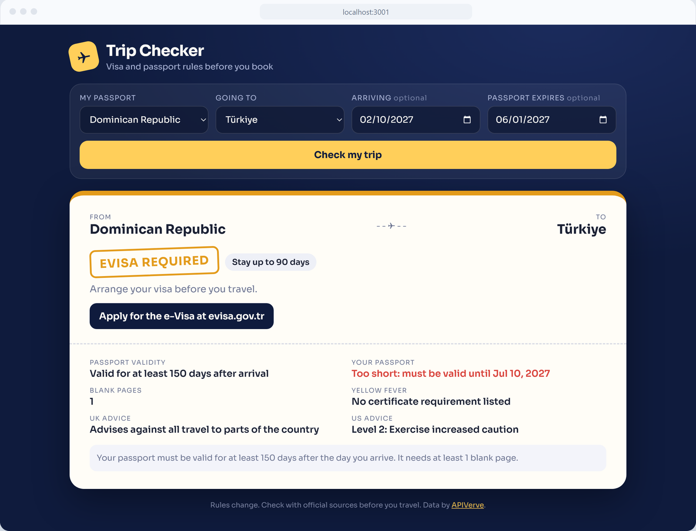

# Trip Checker | APIVerve Template

[](LICENSE)
[](package.json)
[](tsconfig.json)
[](https://apiverve.com/marketplace/visarequirements?utm_source=github&utm_medium=template&utm_campaign=trip-checker-nextjs-tutorial)
[](https://apiverve.com/marketplace/entryrequirements?utm_source=github&utm_medium=template&utm_campaign=trip-checker-nextjs-tutorial)

A trip checker you can deploy in one click. Pick your passport and where you're going, and it tells you whether you need a visa, how long you can stay, and what your passport needs: how long it must stay valid, blank pages and yellow fever rules. Add your travel dates and passport expiry, and it checks whether your passport is good enough for this trip.

[](https://vercel.com/new/clone?repository-url=https%3A%2F%2Fgithub.com%2Fapiverve%2Ftrip-checker-nextjs-tutorial&project-name=trip-checker&repository-name=trip-checker&env=APIVERVE_API_KEY&envDescription=Your%20APIVerve%20API%20key.%20Free%20to%20create%2C%20no%20card%20needed.&envLink=https%3A%2F%2Fdashboard.apiverve.com%2Fsignup%3Fapi%3Dvisarequirements%26utm_source%3Dvercel%26utm_medium%3Dtemplate%26utm_campaign%3Dtrip-checker-nextjs-tutorial)



---

### Get your free API key

This template needs an APIVerve API key. **[Sign up free](https://dashboard.apiverve.com/signup?api=visarequirements&utm_source=github&utm_medium=template&utm_campaign=trip-checker-nextjs-tutorial)**, no credit card required.

---

## Deploy in one click

Click **Deploy with Vercel** above. Vercel copies this repo to your GitHub account, asks for your `APIVERVE_API_KEY`, and gives you a live URL about a minute later.

## Run it locally

```bash
git clone https://github.com/apiverve/trip-checker-nextjs-tutorial.git
cd trip-checker-nextjs-tutorial
npm install
cp .env.example .env   # then set APIVERVE_API_KEY in .env
npm run dev
```

Open `http://localhost:3000`. To see it in a phone and a browser frame side by side, open `http://localhost:3000/showcase.html`.

## How it works

1. `app/page.tsx` is the form and the result, styled as a boarding pass. It opens on `?passport=US&destination=JP`, or the last passport you checked.
2. `app/api/trip/route.ts` checks the two country codes and the optional dates, then calls Visa Requirements and Travel Entry Requirements in parallel. Your API key stays on the server and never reaches the browser. Answers are cached for an hour, and cached answers don't count against the rate limit.
3. The visa answer sets the colour of the ticket: green for no visa, amber for an ETA, eVisa or visa on arrival, red when a visa is needed first.

On a free key you get the visa requirement, the passport validity rule and whether a yellow fever certificate is needed. Paid plans add how long you can stay, the official site to apply on, the passport check against your dates, blank pages, the full guidance and UK and US travel advice. The page shows whatever comes back, so it works on both.

```
app/
  api/trip/route.ts   the server route: validates, calls both APIs, caches
  page.tsx            the form and the boarding-pass result
  layout.tsx          font and metadata
  globals.css         the look, with container queries for phone and desktop
lib/
  apiverve.ts         API call, cache and rate limit helpers
  countries.ts        country codes and names for the pickers
public/showcase.html  the phone and desktop demo frame
```

### The API call

```ts
const res = await fetch('https://api.apiverve.com/v1/visarequirements?passport=US&destination=JP', {
  headers: { 'x-api-key': process.env.APIVERVE_API_KEY! }
});
const { data } = await res.json();
```

## Before you share your URL

Once deployed, anyone who finds your URL can use it on your API key. Each visitor can make 10 uncached requests a minute, and repeat lookups come from the cache, which is fine for a demo. Both are kept in memory, so they aren't shared between serverless instances. For production:

- Put the page behind your own sign-in, or
- Move the limit and cache to a shared store such as [Upstash Redis](https://upstash.com/), or
- Call the route only from your own backend.

## Ideas to extend it

- List every country a passport can visit without a visa with the [Visa Requirements](https://apiverve.com/marketplace/visarequirements) list endpoint.
- Show the local time at the destination with [World Time](https://apiverve.com/marketplace/worldtime).
- Add public holidays during the trip with [World Holidays](https://apiverve.com/marketplace/worldholidays).

## API reference

- [Visa Requirements](https://apiverve.com/marketplace/visarequirements?utm_source=github&utm_medium=template&utm_campaign=trip-checker-nextjs-tutorial): `GET https://api.apiverve.com/v1/visarequirements`
- [Travel Entry Requirements](https://apiverve.com/marketplace/entryrequirements?utm_source=github&utm_medium=template&utm_campaign=trip-checker-nextjs-tutorial): `GET https://api.apiverve.com/v1/entryrequirements`
- [Full documentation](https://docs.apiverve.com?utm_source=github&utm_medium=template&utm_campaign=trip-checker-nextjs-tutorial)

## Tech stack

- **Next.js 16** (App Router) and **React 19**, in **TypeScript**
- A **Route Handler** in `app/api/` for the server side, so the key never reaches the browser
- Deploys to Vercel as-is, with no configuration

## License

MIT. See [LICENSE](LICENSE).
